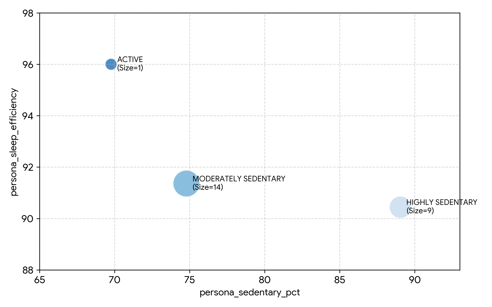
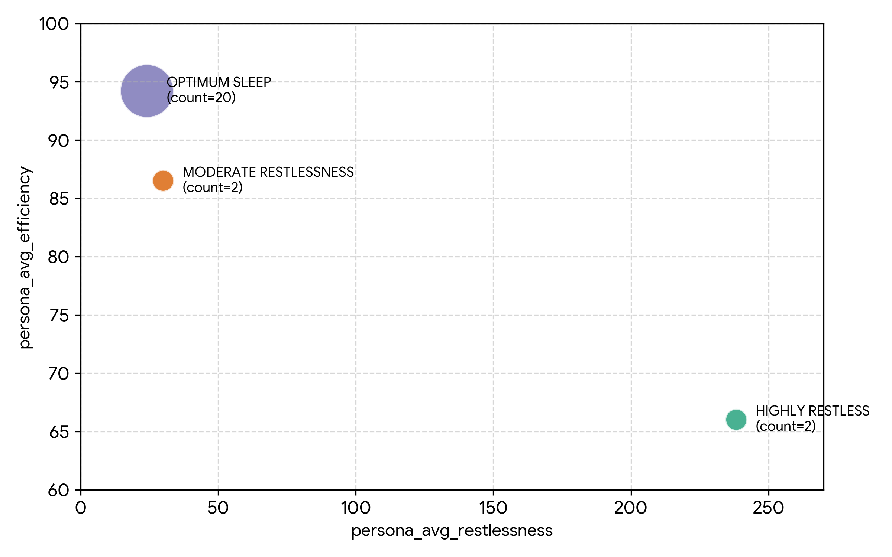
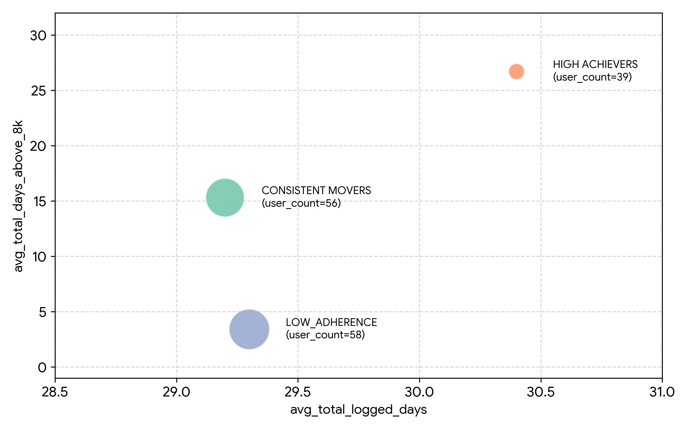

# 📊 Bellabeat Consumer Health & Activity Data Analysis

An end-to-end data engineering and analytics project exploring smart device tracker logs to uncover user behavior patterns, sleep hygiene trends, and benchmark adherence for **Bellabeat**.

---

## 1. Introduction

### Project Scope & Focus
This project analyzes smart device fitness data to help **Bellabeat**—a high-tech manufacturer of health-focused products for women—gain actionable business insights. By evaluating activity levels, sedentary habits, sleep efficiency, and daily step benchmark adherence, the analysis identifies key user personas and engagement gaps to drive product strategy and user retention.

### Code Link
All underlying database schemas, data loading scripts, cleaning routines, and modular analytical queries are available in the repository folder:  
🔗 **[SQL Queries & Automation Scripts](./run_pipeline.sh)**

---

## 2. Background

### Context & Motivation
Transitioning from foundational data analytics coursework (Google Data Analytics Professional Certificate) to real-world business datasets, this project applies advanced SQL methodologies and data engineering workflows learned through specialized training. The goal was to build an automated, modular end-to-end pipeline to solve realistic consumer engagement problems.

### Dataset & Goals
The project utilizes multi-metric smart device tracker datasets covering daily activity, step volume, and sleep tracking metrics across dozens of users over a 30-day period.

### Core Questions Addressed:
1. **Benchmark Adherence:** How frequently do users hit the standard 8,000-step daily movement benchmark, and what engagement cohorts exist?
2. **Activity vs. Sedentary Impact:** How does daily active intensity impact sedentary duration and overall sleep efficiency?
3. **Sleep Restlessness & Hygiene:** What proportion of users experience significant restlessness or time spent in bed prior to falling asleep?
4. **Behavioral Patterns:** Are low-adherence users disengaged from the app, or are they logging into the platform regularly without meeting physical activity goals?

---

## 3. Tools I Used

* **SQL:** The core language used to clean, aggregate, segment, and model user tracker data.
* **PostgreSQL:** Relational database management system used to stage, store, and execute analytical models.
* **Visual Studio Code / DBeaver:** Integrated development environments for SQL execution, database administration, and pipeline management.
* **Bash Shell Scripting:** Automated end-to-end pipeline orchestration script (`run_pipeline.sh`) utilizing the `psql` command-line tool.
* **Git & GitHub:** Version control, pipeline documentation, and codebase publishing.

---

## 📌 Executive Summary

Bellabeat empowers women with health data, but driving sustained daily user engagement remains a core growth challenge. This project leverages a **four-rank analytical framework** to evaluate user behavior across activity personas, sleep hygiene, sedentary habits, and benchmark adherence. 

### Below are the questions we wanted to answer through my SQL queries:
1. How does daily active intensity impact sedentary duration and overall sleep efficiency across different user activity personas?
2. What proportion of users experience significant restlessness or time spent awake in bed, and how does it correlate with sleep efficiency?
3. How frequently do users hit the standard 8,000-step daily movement benchmark over a 30-day period, and what distinct adherence cohorts emerge?
4. Are low-adherence users disengaged from the app entirely, or are they logging into the platform regularly while failing to hit physical activity goals?

### Key Findings:

* **Activity-Sleep Synergy:** Higher physical activity directly correlates with superior sleep metrics. Users categorized in active personas demonstrated up to **96% sleep efficiency**, whereas highly sedentary users exhibited lower sleep efficiency and higher restlessness.
* **Sleep Hygiene Concentration:** The majority of tracked users belong to the *Optimum Sleep* cohort, though a subset experiences severe sleep restlessness (>230 minutes of awake/restless time in bed).
* **High Logging Consistency vs. Variable Movement:** Across all adherence cohorts, users log into the app regularly (~29–30 days over a 30-day period). However, step target attainment varies drastically: **Low Adherence** users hit the 8,000-step benchmark an average of only **3.4 days**, while **High Achievers** reach it **26.7 days**.


---

## 🛠️ Data Architecture & Tech Stack

* **Database Engine:** PostgreSQL
* **Scripting & Automation:** Bash Shell Scripting (`psql` CLI automation)
* **Analytical Techniques:**
  * Modular Common Table Expressions (CTEs)
  * Conditional Aggregations (`COUNT(CASE WHEN ...)` / `AVG(CASE WHEN ...)`)
  * Date/Time Truncation (`DATE_TRUNC`) and Behavioral Bucketing
  * Standard Aggregations & Grouping (GROUP BY, SUM, AVG, COUNT)

---

## 🏗️ Repository & Directory Structure

```text
Bellabeat_Analysis_Project/
├── Data/
│   ├── cleaned/
│   │   ├── cleaned_daily_activity.csv
│   │   └── cleaned_daily_sleep.csv
│   └── raw/
│       ├── dailyActivity_merged.csv
│       └── sleepDay_merged.csv
├── docs/
├── SQL/
│   ├── 01_schema_staging.sql
│   ├── 02_data_loading.sql
│   ├── 03_data_cleaning.sql
│   ├── 04_sedentary_vs_sleep_impact.sql
│   ├── 05_sleep_hygiene.sql
│   └── 06_activity_adherence.sql
├── .gitignore
├── README.md
└── run_pipeline.sh
```


## ⚡ Automated Pipeline Execution

The entire data lifecycle—from staging tables to final analytical models—is orchestrated via the shell script `run_pipeline.sh`.

* I built this using the Google Gemini*

### To Run the Pipeline Locally:

1. **Clone the repository:**
   ```bash
   git clone https://github.com/Dikevictor/bellabeat-analysis.git
   cd bellabeat-analysis
   ```

2. **Make the pipeline script executable:**
   ```bash
   chmod +x run_pipeline.sh
   ```

3. **Execute the automation script:**
   ```bash
   ./run_pipeline.sh
   ```

---

## 1. Introduction

### Project Scope & Focus
This project analyzes smart device fitness data to help **Bellabeat**—a high-tech manufacturer of health-focused products for women—gain actionable business insights. By evaluating activity levels, sedentary habits, sleep efficiency, and daily step benchmark adherence, the analysis identifies key user personas and engagement gaps to drive product strategy and user retention.

### Code Link
All underlying database schemas, data loading scripts, cleaning routines, and modular analytical queries are available in the repository folder:  
🔗 **[SQL Queries & Automation Scripts](./SQL)**

---

## 2. Background

### Context & Motivation
Transitioning from foundational data analytics coursework (Google Data Analytics Professional Certificate) to real-world business datasets, this project applies advanced SQL methodologies and data engineering workflows learned through specialized training. The goal was to build an automated, modular end-to-end pipeline to solve realistic consumer engagement problems.

### Dataset & Goals
The project utilizes multi-metric smart device tracker datasets covering daily activity, step volume, and sleep tracking metrics across dozens of users over a 30-day period.

### Core Questions Addressed:
1. **Benchmark Adherence:** How frequently do users hit the standard 8,000-step daily movement benchmark, and what engagement cohorts exist?
2. **Activity vs. Sedentary Impact:** How does daily active intensity impact sedentary duration and overall sleep efficiency?
3. **Sleep Restlessness & Hygiene:** What proportion of users experience significant restlessness or time spent in bed prior to falling asleep?
4. **Behavioral Patterns:** Are low-adherence users disengaged from the app, or are they logging into the platform regularly without meeting physical activity goals?

---

## 3. Tools I Used

* **SQL:** The core language used to clean, aggregate, segment, and model user tracker data.
* **PostgreSQL:** Relational database management system used to stage, store, and execute analytical models.
* **Visual Studio Code / DBeaver:** Integrated development environments for SQL execution, database administration, and pipeline management.
* **Bash Shell Scripting:** Automated end-to-end pipeline orchestration script (`run_pipeline.sh`) utilizing the `psql` command-line tool.
* **Git & GitHub:** Version control, pipeline documentation, and codebase publishing.

---

## 4. The Analysis

---

### 1. Sedentary versus Sleep Impact

#### Visualization



*This is a bar chart of the top 10 skills associated with the top 10 paying jobs. Graph was generated by Google Gemini*

#### Query & Methodology
Joined daily activity logs with sleep data to categorize users into activity personas and cross-examine sedentary percentage against sleep efficiency metrics.

```sql

-- CTE 1: Sedentary Percentage
WITH user_activity_summary AS ( 
    
    SELECT 
    user_id,
    ROUND(AVG(sedentary_minutes)::NUMERIC, 1) AS avg_sedentary_mins,
    ROUND(AVG(lightly_active_minutes)::NUMERIC, 1) AS avg_lightly_active_mins,
    ROUND(AVG(fairly_active_minutes)::NUMERIC, 1) AS avg_fairly_active_mins,
    ROUND(AVG(very_active_minutes)::NUMERIC, 1) AS avg_very_active_mins,

    ROUND(
            (AVG(sedentary_minutes)::NUMERIC / 
             NULLIF(AVG(lightly_active_minutes) + AVG(fairly_active_minutes) 
             + AVG(very_active_minutes) + AVG(sedentary_minutes),0
                    )
            ) * 100,
        2
        ) AS sedentary_pct

FROM cleaned_daily_activity 

GROUP BY 
    user_id

),

-- CTE 2: Activity_Persona
persona_pct AS (
    SELECT
        user_id,
        sedentary_pct,

        CASE 
            WHEN sedentary_pct > 80 THEN 'HIGHLY SEDENTARY'
            WHEN sedentary_pct < 70 THEN 'ACTIVE'
            ELSE 'MODERATELY SEDENTARY'
        END AS activity_persona 

    FROM user_activity_summary

),

-- CTE 3: Counting Persona
count_of_persona AS (
    SELECT 
        activity_persona,
        COUNT(user_id) AS Persona_count
        

    FROM persona_pct

    GROUP BY
        activity_persona
    ORDER BY 
        persona_count DESC

),


-- CTE 4: Sleep Efficiency
efficient_sleep AS (
    SELECT
        user_id,
        ROUND(AVG(total_minutes_asleep)::NUMERIC, 1) AS avg_tot_min_asleep,
        ROUND(AVG(total_time_in_bed)::NUMERIC, 1) AS avg_tot_time_in_bed,

        ROUND(
            AVG(total_minutes_asleep)::NUMERIC / AVG(total_time_in_bed)
            , 2) * 100 
        AS user_sleep_efficiency
    FROM cleaned_daily_sleep

    GROUP BY
        user_id
),

-- CTE 5: Sedentary_pct Vs Sleep efficiency 

sedentary_sleep AS (
    SELECT 
    pp.user_id,
    sedentary_pct,
    user_sleep_efficiency,
    activity_persona

FROM persona_pct pp
    LEFT JOIN efficient_sleep es 
    ON pp.user_id = es.user_id

WHERE user_sleep_efficiency IS NOT NULL

ORDER BY 
    sedentary_pct DESC

)

SELECT 
    activity_persona,
    ROUND(AVG(sedentary_pct), 2) AS persona_sedentary_pct,
    ROUND(AVG(user_sleep_efficiency), 2) AS persona_sleep_efficiency,
    COUNT(user_id) AS Persona_size

FROM Sedentary_sleep

GROUP BY
    activity_persona
ORDER BY 
    persona_sleep_efficiency DESC;
```
- Link to full script: [`sedentary_vs_sleep_impact`](SQL/04_sedentary_vs_sleep_impact.sql)

#### Key Insights
* **Active Personas Sleep Better:** The **Active** persona demonstrated a **96.00% sleep efficiency**.
* **High Sedentary Burden:** **Highly Sedentary** users average **89.04% sedentary time** during waking hours and exhibit lower sleep efficiency.

#### Summary Table

<!-- INSERT IMAGE HERE: e.g.  -->

| Activity Persona | Sedentary Time (%) | Sleep Efficiency (%) | User Count |
| :--- | :---: | :---: | :---: |
| **Active** | 69.76% | 96.00% | 1 |
| **Moderately Sedentary** | 74.78% | 91.36% | 14 |
| **Highly Sedentary** | 89.04% | 90.44% | 9 |

---

### 2. Sleep Hygiene & Restlessness 

#### Visualization



*This is a bar chart of the top 10 skills associated with the top 10 paying jobs. Graph was generated by Google Gemini*

#### Query & Methodology
Segmented users into sleep cohorts based on total restless duration in bed (time in bed minus time asleep) to isolate sleep efficiency issues.

```sql

-- CTE 1: Sleep Efficiency 
WITH sleep_efy_restlness AS (
    SELECT 
        user_id,
            ROUND(AVG(total_minutes_asleep)::NUMERIC, 1) AS avg_tot_min_asleep,
            ROUND(AVG(total_time_in_bed)::NUMERIC, 1) AS avg_tot_time_in_bed,
            ROUND(AVG(total_time_in_bed)::NUMERIC, 1) - ROUND(AVG(total_minutes_asleep)::NUMERIC, 1) AS avg_restlessness,

            ROUND(
                AVG(total_minutes_asleep)::NUMERIC / AVG(total_time_in_bed)
                , 2) * 100 
            AS user_sleep_efficiency
    
    FROM cleaned_daily_sleep

    GROUP BY
        user_id

),

-- CTE 2: Sleep Persona
sleep_personas AS (
    SELECT 
        user_id,
        avg_restlessness,
        user_sleep_efficiency,

    -- Sleep persona
        CASE 
            WHEN user_sleep_efficiency > 90 THEN 'OPTIMUM SLEEP'
            WHEN user_sleep_efficiency < 75 THEN 'HIGHLY RESTLESS'
            ELSE 'MODERATE RESTLESSNESS'
        END AS sleep_persona

    FROM sleep_efy_restlness

    ORDER BY user_sleep_efficiency
)

SELECT 
    sleep_persona,
    ROUND(AVG(avg_restlessness)::NUMERIC, 1) AS persona_avg_restlessness,
    ROUND(AVG(user_sleep_efficiency)::NUMERIC, 1) AS persona_avg_efficiency,
    COUNT(user_id)
    
FROM sleep_personas

GROUP BY 
    sleep_persona

ORDER BY 
    persona_avg_restlessness DESC;

```

- Link to full script: [`05_sleep_hygiene.sql`](SQL/05_sleep_hygiene.sql)

#### Key Insights
* **Optimum Sleep Majority:** The vast majority of tracked users (20 out of 24) fall into the **Optimum Sleep** tier with low restless duration (24.1 min avg).
* **Severe Restlessness Subset:** A small group (**Highly Restless**) spends an average of **238.3 minutes (~4 hours)** restless/awake in bed, dropping sleep efficiency to **66.0%**.

#### Summary Table

<!-- INSERT IMAGE HERE: e.g.  -->

| Sleep Persona | Avg. Restless Time (min) | Avg. Sleep Efficiency (%) | User Count |
| :--- | :---: | :---: | :---: |
| **Optimum Sleep** | 24.1 | 94.2% | 20 |
| **Moderate Restlessness** | 30.0 | 86.5% | 2 |
| **Highly Restless** | 238.3 | 66.0% | 2 |

---

### 3. Activity Benchmark Adherence

#### Visualization



*This is a bar chart of the top 10 skills associated with the top 10 paying jobs. Graph was generated by Google Gemini*

#### Query & Methodology
Filtered user tracking logs using modular CTEs (`DATE_TRUNC`, conditional aggregation, and window functions) to evaluate how consistently users achieve the **8,000-step daily benchmark** over a 30-day period.

```sql
-- CTE 1: Total Logged Days
WITH logged_days AS (
    SELECT DISTINCT
        user_id,
        activity_date,
        total_steps

    FROM cleaned_daily_activity

    GROUP BY 
        user_id,
        activity_date,
        total_steps
),

-- CTE 2: Calculating Bench
benchmark_cal AS (
SELECT 
    user_id,
    COUNT(activity_date) AS total_logged_days,
    COUNT(CASE WHEN total_steps >= 8000 THEN 1 END) AS total_days_above_8k,
    ROUND (
        (COUNT(CASE WHEN total_steps >= 8000 THEN 1 END)::NUMERIC/COUNT(activity_date)) * 100
        , 2
        ) AS benchmark_count

FROM logged_days

GROUP BY 
    user_id

),

-- CTE 3: Weekly_consistency
Weekly_consistency AS (
SELECT 
    user_id, 
    DATE_TRUNC('week', activity_date) AS activity_week,
    COUNT(DISTINCT activity_date) AS active_days_per_week

FROM logged_days

GROUP BY
    user_id,
    activity_week

),

-- CTE 4: Combining benchmark metrics and weekly averages
combination AS (
SELECT
    bc.user_id,
    bc.total_logged_days,
    bc.total_days_above_8k,
    bc.benchmark_count,
    ROUND(
        AVG(wc.active_days_per_week), 1
    ) AS avg_weekly_active_days

FROM benchmark_cal bc
JOIN Weekly_consistency wc
ON  bc.user_id = wc.user_id

GROUP BY 
    bc.user_id,
    bc.total_logged_days,
    bc.total_days_above_8k,
    bc.benchmark_count

ORDER BY 
    bc.benchmark_count DESC,
    avg_weekly_active_days DESC

)

SELECT
    COUNT(bc.user_id) AS User_Count,
    ROUND(AVG(bc.total_logged_days), 1) AS avg_total_logged_days,
    ROUND(AVG(bc.total_days_above_8k), 1) AS avg_total_days_above_8k,
        CASE 
            WHEN bc.benchmark_count >= 75 THEN 'HIGH ACHIEVERS'
            WHEN bc.benchmark_count < 40 THEN 'LOW_ADHERENCE'
            ELSE 'CONSISTENT MOVERS'
        END AS benchmark_cohort

FROM benchmark_cal bc
JOIN Weekly_consistency wc
ON  bc.user_id = wc.user_id

GROUP BY
    benchmark_cohort

ORDER BY 
    benchmark_cohort
```
Link to full script: [`06_activity_adherence.sql`](SQL/06_activity_adherence.sql)

#### Key Insights
* **High App Engagement Across All Groups:** Users in every cohort log into the app consistently (~29 to 30 days out of 30), proving that app retention is high.
* **Vast Goal Disparity:** Despite logging in equally, **Low Adherence** users hit the 8k step goal an average of only **3.4 days**, whereas **High Achievers** reach it **26.7 days**.

#### Summary Table

<!-- INSERT IMAGE HERE: e.g.  -->

| Benchmark Cohort | User Count | Avg. Total Logged Days | Avg. Days ≥ 8k Steps |
| :--- | :---: | :---: | :---: |
| **Low Adherence** | 58 | 29.3 | 3.4 |
| **Consistent Movers** | 56 | 29.2 | 15.3 |
| **High Achievers** | 39 | 30.4 | 26.7 |


## 5. What I Learned

* **Modular CTE Architecture:** Designing structured, reusable CTE blocks to maintain clean code and chain complex aggregations logically.
* **Automated Data Engineering Pipelines:** Building executable Bash scripts (`run_pipeline.sh`) to automate schema creation, raw CSV loading, cleaning, and EDA execution via CLI commands.
* **Advanced SQL Functions:** Applying window functions, date truncation (`DATE_TRUNC`), type casting, and conditional aggregations (`COUNT(CASE WHEN ...)`).
* **Analytical Thinking:** Translating abstract marketing and product questions into executable, business-ready SQL models.

---

## 6. Conclusions

### Insights Summary
1. **App Logging ≠ Movement Attainment:** Low-adherence users are actively opening the app (~29.3 logged days) but fail to meet step goals, proving the product challenge is goal setting, not app churn.
2. **Sedentary Reduction is Key:** Decreasing sedentary duration directly correlates with better sleep efficiency.
3. **Targeted Features Needed:** Sleep restlessness is isolated to specific power-user edge cases requiring specialized coaching features.

### Strategic Recommendations
* **Dynamic Goal Milestones:** Offer adaptive step goals (e.g., 5,000–6,500 steps) for **Low Adherence** users instead of an uncompromising 8,000-step target.
* **Sedentary Movement Nudges:** Implement hourly "time-to-move" prompts during working hours for the **Highly Sedentary** cohort.
* **Sleep Hygiene Reminders:** Introduce evening wind-down content for the **Highly Restless** segment to help reduce awake time in bed.

### Closing Thoughts
Building this project deepened my technical proficiency in PostgreSQL pipeline design and shell scripting while strengthening my ability to translate complex database metrics into high-impact business strategy.

---

## 👤 Author

* GitHub: [Dikevictor](https://github.com/Dikevictor)
* LinkedIn: [Dike Victor Nwabuokei](https://linkedin.com/in/your-linkedin-profile)